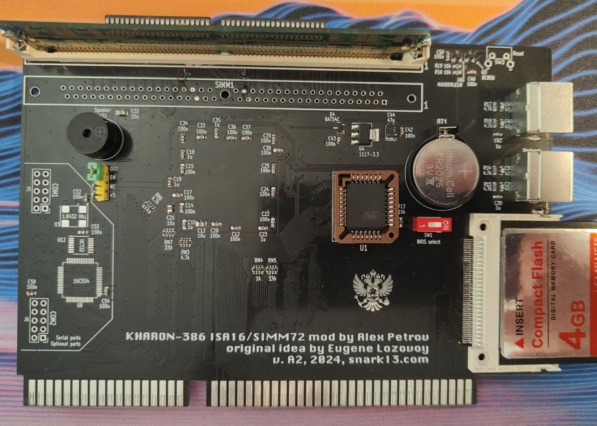
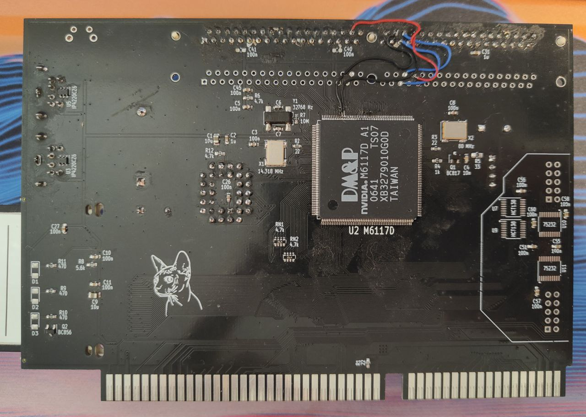
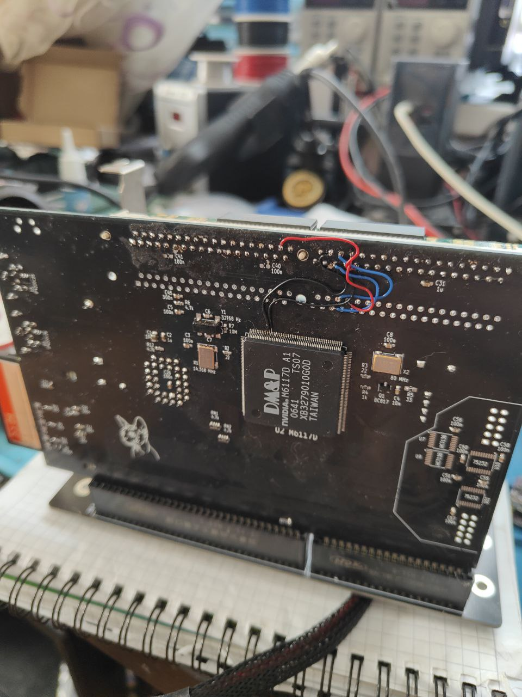
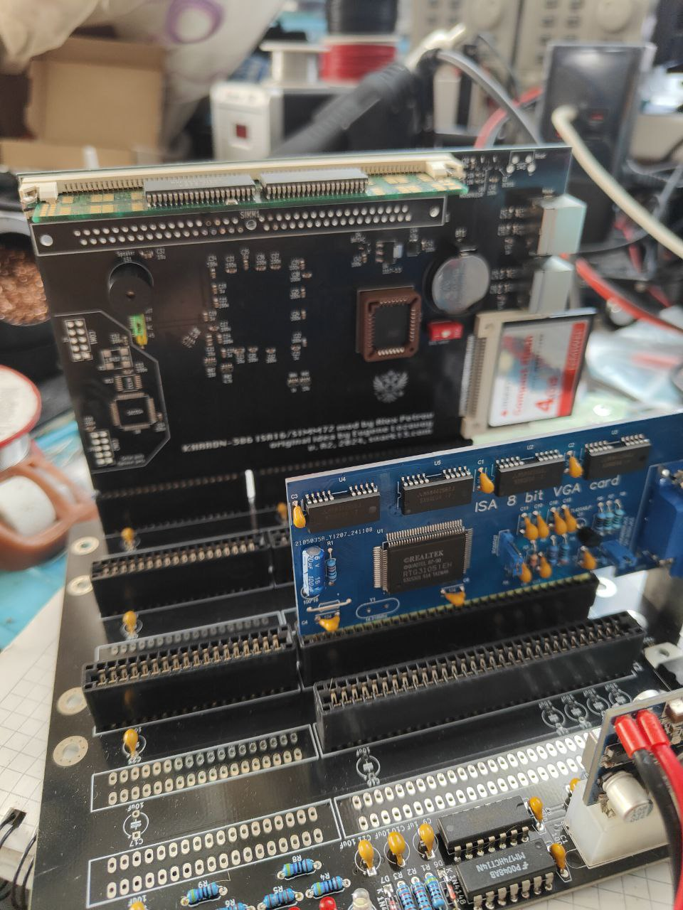

# Basilea

IBM PC совместимая процессорная плата на базе M6117D System-On-Chip с интегрированным 386SX40 CPU и M1217B чипсетом

## Specification -

- 2 SIMM72 слота для RAM
    -  поддерживаются только односторонние модули (двусторонние модули могут определяться не полного размера, так же модули у которых в чипах количество столбцов отличается от количество рядов могут определяться не полностью)
    - поддерживаются как EDO так и FPM память (одновременная работа двух модулей разного типа не проверялась и не гарантируется), 
    - максимальный объем памяти - 32 мегабайта
- PS/2 порты для клавиатуры и мыши
- 2 COM порта
- слот для CF карты
- Real-time clock (RTC) с резервной батареей
- PC-speaker

## Changes

- Version 1.2.2
    - Оптимизация расположения элементов
    - все конденсаторы 0.1u и больше заменены на 0805
- Version 1.1
    - обновлен Silksreen
- Version 1.0
    - Оптимизация расположения элементов
- Version 0.6
    - пофикшена разводка сигналов CAS/RAS к SIMM слотам
- Version 0.3
    - первая версия реализованная в железе

## Images
Изображения версии 0.3 в папке images/0.3

 

 
Первая версия во время тестов -
 

## Related projects
Данный проект основан на проекте Евгения Лозового Kharon-386 -

https://github.com/UzixLS/pc-kharon-386
