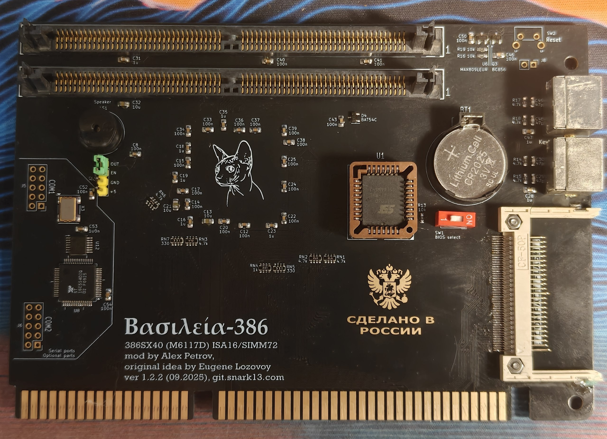
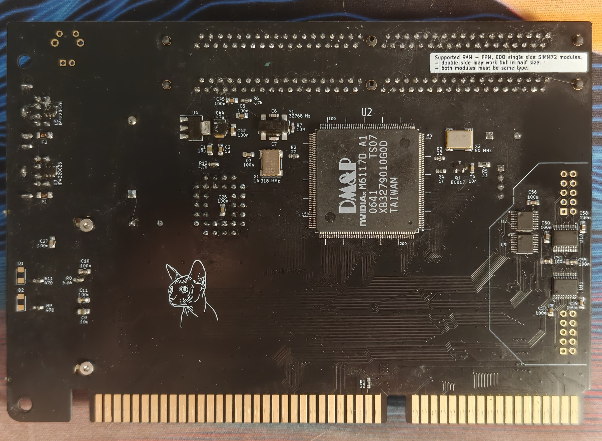
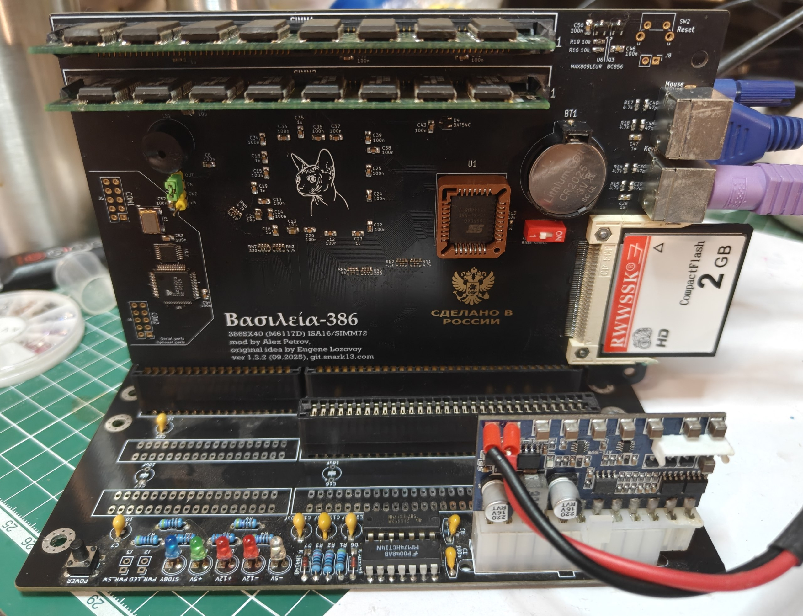

# Basilea PC Card

[Русская версия](README_RU.md)

Main project repository: [git.snark13.com/snark13/basilea](https://git.snark13.com/snark13/basilea.git).

GitHub mirror: [github.com/snark013/pc-card-basilea](https://github.com/snark013/pc-card-basilea.git).

Basilea is an IBM PC-compatible processor board based on the M6117D system-on-chip, which integrates a 40 MHz 386SX processor and the M1217B chipset. The project is designed in KiCad.

Basilea is based on Evgeny Lozovoy’s [Kharon-386](https://github.com/UzixLS/pc-kharon-386) project.

## Project status

Version 1.2.2 has been assembled and tested. Release files are available in the repository.

A 32 MB RAM configuration using two 16 MB SIMMs has been tested. Mixed EDO and FPM operation has not been tested.

## Key features

- 40 MHz 386SX processor and M1217B chipset integrated into the M6117D.
- Two 72-pin SIMM slots supporting up to 32 MB of RAM.
- EDO and FPM memory support.
- PS/2 keyboard and mouse ports.
- Two serial COM ports.
- CompactFlash (CF) card slot.
- Battery-backed real-time clock (RTC).
- PC speaker.

## RAM

The board provides two 72-pin SIMM slots and supports up to 32 MB of RAM. A configuration with two 16 MB modules has been tested.

- Single-sided modules are supported. Double-sided modules may be detected at less than their full capacity.
- Modules whose memory chips use different numbers of row and column address bits may also be detected at less than their full capacity.
- Both EDO and FPM modules are supported. Using two modules of different types together has not been tested and is not guaranteed to work.

## Project files

- [basilea.kicad_pro](basilea.kicad_pro) — KiCad project.
- [basilea.kicad_sch](basilea.kicad_sch) — schematic.
- [basilea.kicad_pcb](basilea.kicad_pcb) — PCB layout.
- [basilea.pretty/](basilea.pretty/) and [Modules.pretty/](Modules.pretty/) — local footprint libraries.
- [docs/](docs/) — reference documentation.
- [release/](release/) — release files: Gerber files, PDF schematics, and interactive bills of materials.
- [images/1.2.2/](images/1.2.2/) — photos of the assembled version 1.2.2 board.

### Release files

| Version | Gerber files | Schematic | Interactive bill of materials |
| --- | --- | --- | --- |
| 1.2.2 | [ZIP](release/1.2.2/gerber.zip) | [PDF](release/1.2.2/basilea.pdf) | [HTML](release/1.2.2/ibom.html) |

## Revision history

### 1.2.2

- Optimized component placement.
- Changed all capacitors below 0.1 µF to the 0603 package size.
- Built the second working board version.

### 1.1

- Updated PCB silkscreen.

### 1.0

- Optimized component placement.

### 0.6

- Corrected CAS/RAS signal routing to the SIMM slots.

### 0.3

- Built the first board version.
- Identified incorrect CAS/RAS signal routing to the SIMM slots; corrected in version 0.6.

## Photos

Assembled version 1.2.2 board.

[Photos of the version 0.3 board](images/0.3/).
