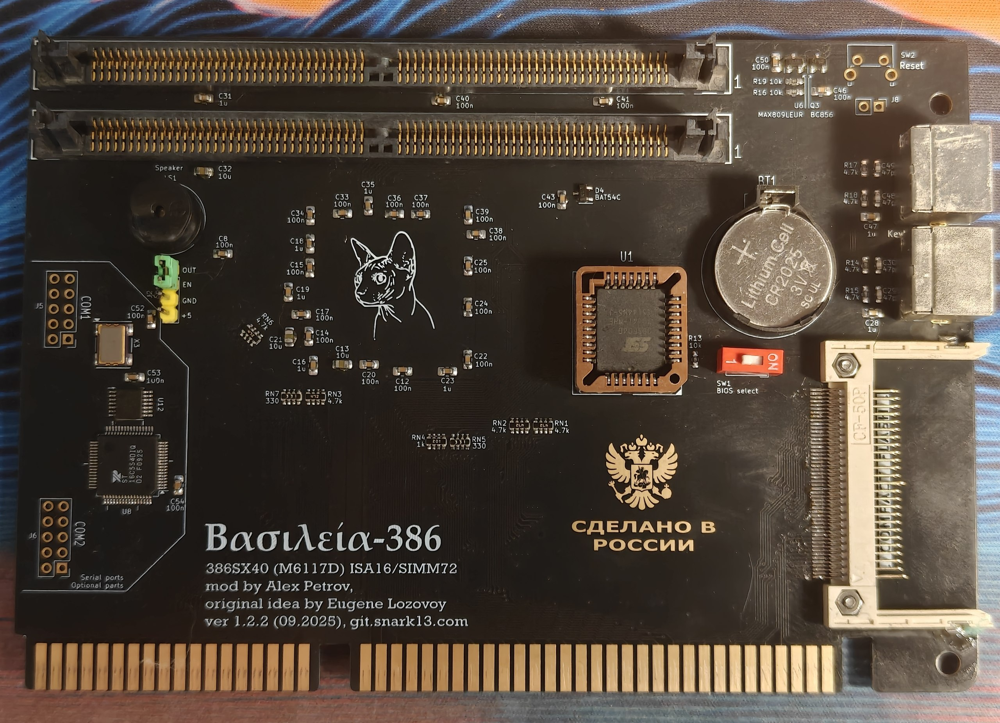
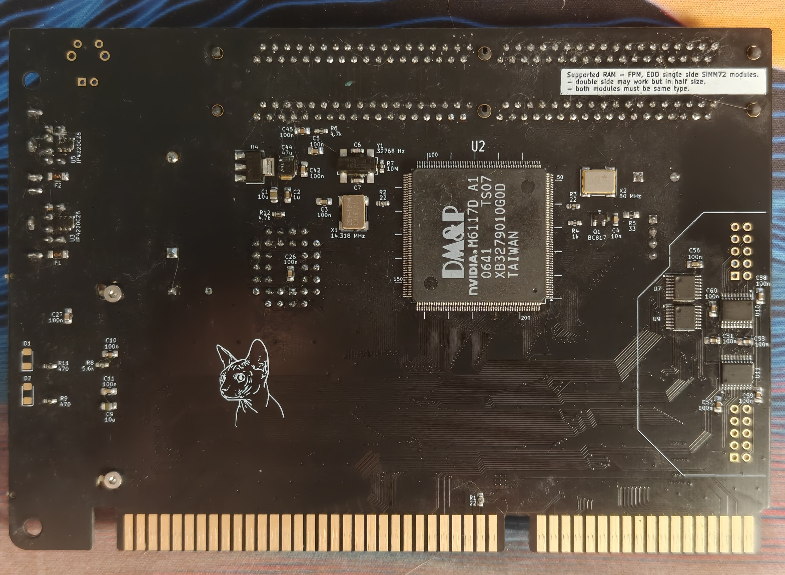
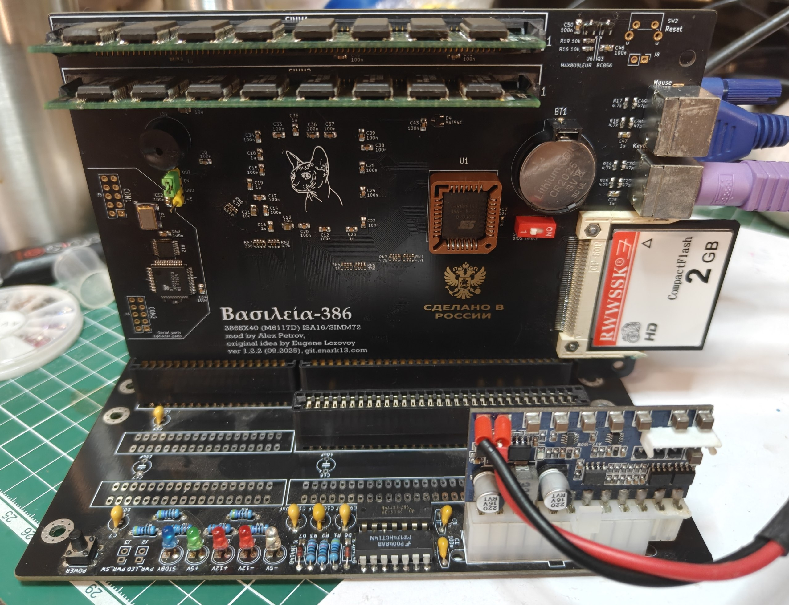

# Basilea — процессорная плата IBM PC

[English version](README.md)

Основной репозиторий проекта: [git.snark13.com/snark13/basilea](https://git.snark13.com/snark13/basilea.git).

Зеркало на GitHub: [github.com/snark013/pc-card-basilea](https://github.com/snark013/pc-card-basilea.git).

Basilea — IBM PC-совместимая процессорная плата на базе системы на кристалле M6117D с процессором 386SX на частоте 40 МГц и интегрированным чипсетом M1217B. Проект выполнен в KiCad.

В основе Basilea лежит проект [Kharon-386](https://github.com/UzixLS/pc-kharon-386) Евгения Лозового.

## Состояние проекта

Версия 1.2.2 собрана и проверена в работе. Материалы выпуска доступны в репозитории.

Проверена конфигурация с 32 МБ оперативной памяти: два модуля SIMM по 16 МБ. Совместная работа модулей EDO и FPM не проверялась.

## Основные характеристики

- Процессор 386SX на частоте 40 МГц и чипсет M1217B в составе M6117D.
- Два слота для 72-контактных модулей SIMM, до 32 МБ оперативной памяти.
- Поддержка памяти EDO и FPM.
- Порты PS/2 для клавиатуры и мыши.
- Два последовательных порта COM, доступных для подключения.
- Слот для карты CompactFlash (CF).
- Часы реального времени (RTC) с резервной батареей.
- Системный динамик (PC speaker).

## Оперативная память

Предусмотрены два слота для 72-контактных модулей SIMM. Максимальный объём памяти — 32 МБ; проверена установка двух модулей по 16 МБ.

- Поддерживаются односторонние модули. Двусторонние модули могут определяться не в полном объёме.
- Модули с микросхемами, у которых число адресных разрядов строк и столбцов различается, также могут определяться не в полном объёме.
- Поддерживаются модули EDO и FPM. Совместная работа двух модулей разных типов не проверялась и не гарантируется.

## BIOS

В каталоге [roms/](roms/) находятся отдельные образы BIOS AWARD и AMI, а также объединённый образ, содержащий обе версии. При использовании объединённого образа версия BIOS выбирается переключателем SW1.

**Рекомендуется использовать BIOS AMI.**

## Последовательные порты

Контроллер последовательных портов содержит четыре COM-порта, и все четыре определяются в системе. На печатной плате разведены и доступны для подключения только два из них.

## Файлы проекта

- [basilea.kicad_pro](basilea.kicad_pro) — проект KiCad.
- [basilea.kicad_sch](basilea.kicad_sch) — принципиальная схема.
- [basilea.kicad_pcb](basilea.kicad_pcb) — печатная плата.
- [basilea.pretty/](basilea.pretty/) и [Modules.pretty/](Modules.pretty/) — локальные библиотеки посадочных мест.
- [docs/](docs/) — справочная документация.
- [roms/](roms/) — образы BIOS AWARD, AMI и объединённый образ.
- [release/](release/) — материалы выпусков: Gerber-файлы, схема в PDF и интерактивный список компонентов.
- [images/1.2.2/](images/1.2.2/) — фотографии собранной платы версии 1.2.2.

### Материалы выпусков

| Версия | Gerber-файлы | Схема | Интерактивный список компонентов |
| --- | --- | --- | --- |
| 1.2.2 | [ZIP](release/1.2.2/gerber.zip) | [PDF](release/1.2.2/basilea.pdf) | [HTML](release/1.2.2/ibom.html) |

## История изменений

### 1.2.2

- Оптимизировано расположение компонентов.
- Для всех конденсаторов ёмкостью менее 0,1 мкФ выбран типоразмер 0603.
- Собран второй работающий вариант платы.

### 1.1

- Обновлена шелкография платы.

### 1.0

- Оптимизировано расположение компонентов.

### 0.6

- Исправлена разводка сигналов CAS/RAS к слотам SIMM.

### 0.3

- Собран первый вариант платы.
- Обнаружена некорректная разводка сигналов CAS/RAS к слотам SIMM; исправлена в версии 0.6.

## Фотографии

Собранная плата версии 1.2.2.

[Фотографии платы версии 0.3](images/0.3/).
